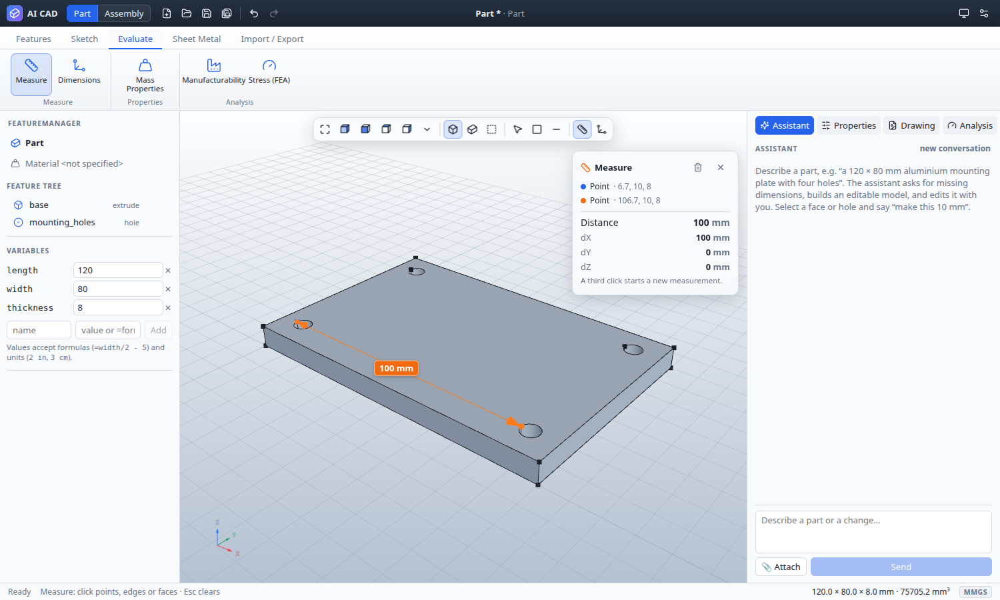
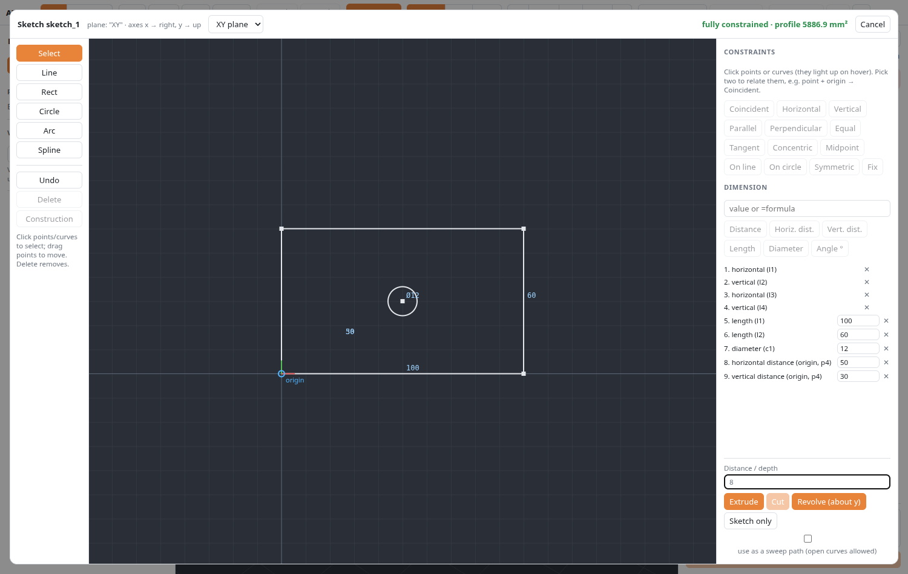
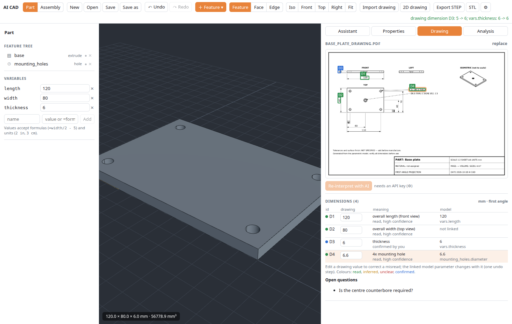
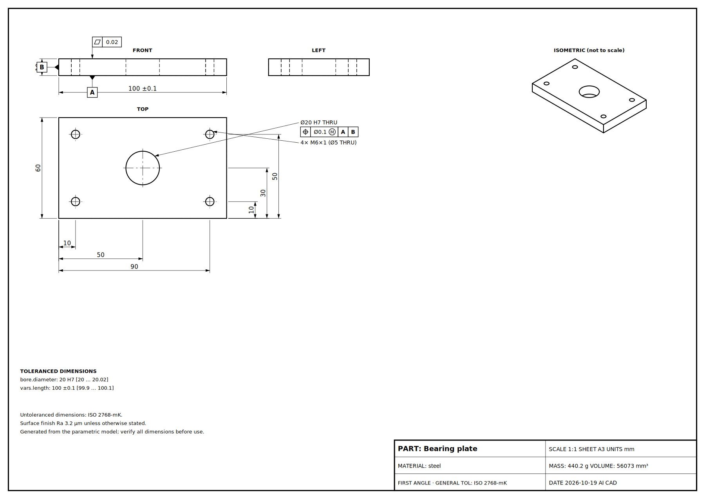
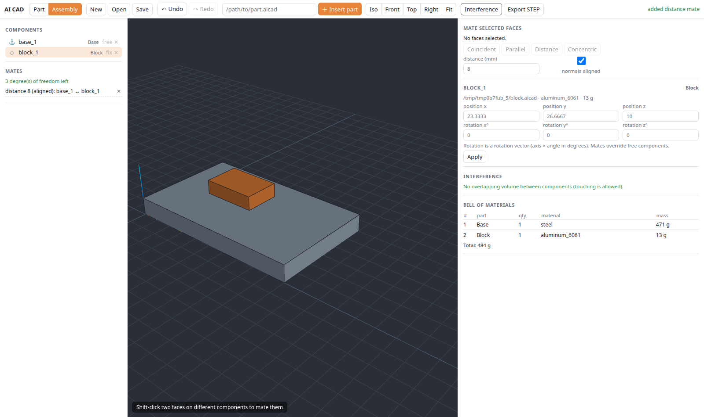
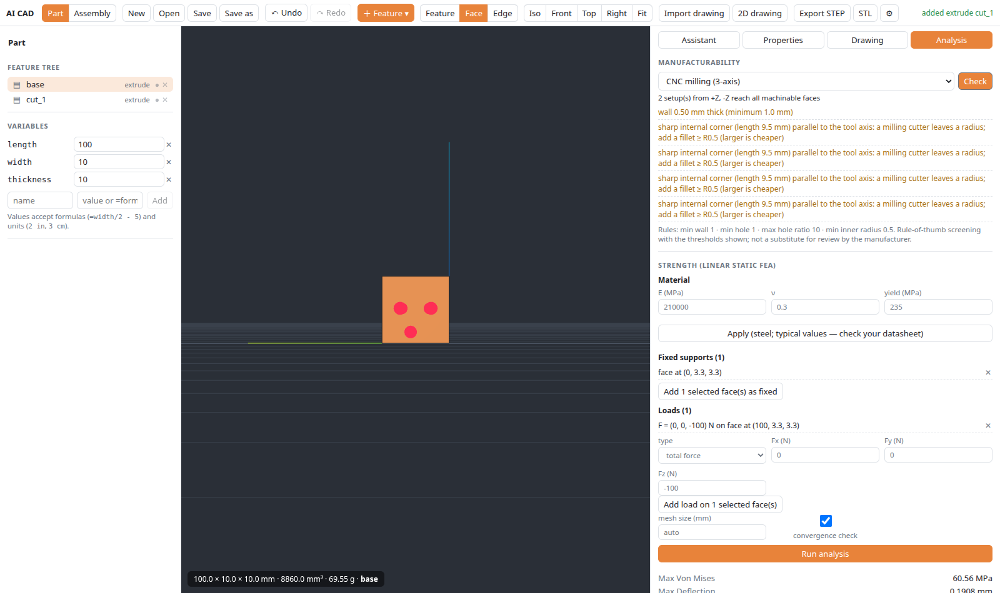
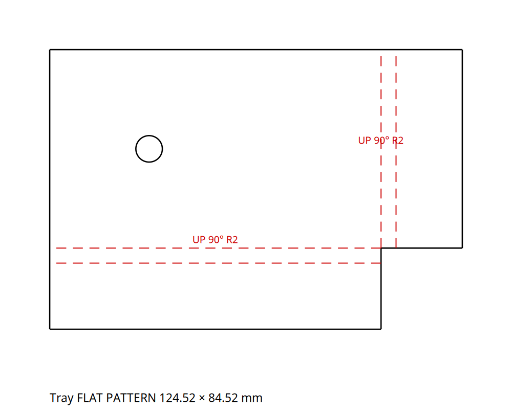
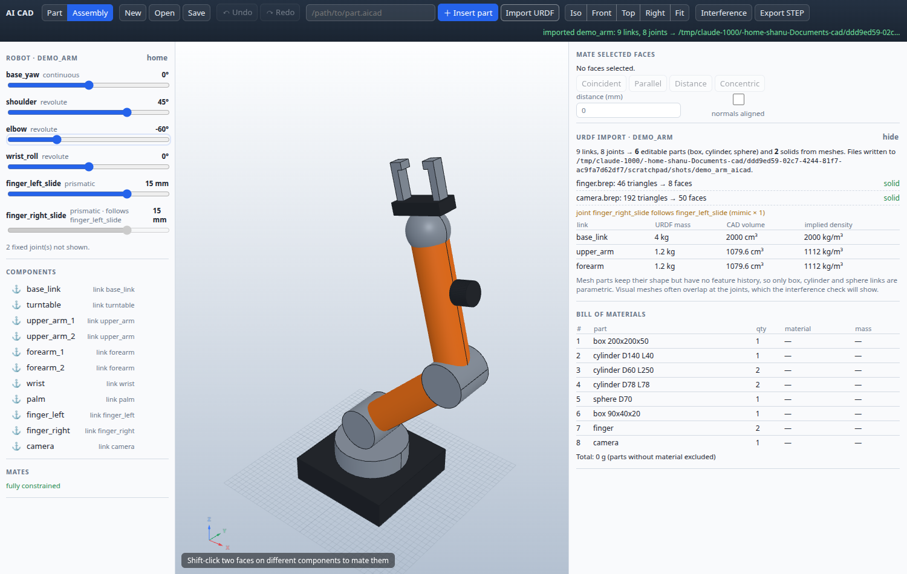

# AI CAD

**Free, open-source parametric CAD for mechanical parts, with an AI design assistant built in.** Bring your own AI: your Claude login, any API, or a free local model.

Describe a part or drop in a drawing. The assistant asks for whatever it needs, then builds an **editable parametric model**. You and the AI then edit the **same** model, through chat or manual CAD tools. Every AI action is a validated CAD command, checked by the geometry kernel and undoable. Nothing is generated blind.



## Features

| | |
|---|---|
| **Parametric modelling** | Feature tree containing: constraint sketches, extrude/cut, revolve, sweep, loft, holes (counterbore, countersink, tapped), threads, fillet, chamfer, shell, patterns, mirror. Variables with formulas (`=width/2 - 5`) and units (`2 in`) |
| **Measure** | Point-to-point, edge, face and hole-centre distances with dX/dY/dZ, angles, diameters and areas, drawn as dimensions in the 3D view; overall part dimensions on demand |
| **Constraint sketcher** | Lines, arcs, circles and splines; 13 constraint types plus dimensions; a fixed origin; live degree-of-freedom and conflict reporting |
| **AI assistant** | Builds and edits through validated tools, asks about missing dimensions, records requirements separately from assumptions, and proposes redesign alternatives you accept with one click |
| **Drawing → CAD** | Import a PDF or image. Every dimension is traced to its spot on the drawing and to the model parameter it drives; mismatches are flagged and you can correct them there |
| **2D drawings** | Hidden-line views (first or third angle) with dimensions, hole and thread callouts, ISO 286 fits, ISO 2768, GD&T frames, datums and surface finish. PDF/SVG export |
| **Analysis** | Linear-static FEA (quadratic tetrahedra) validated against beam theory; manufacturability checks for CNC milling, FDM printing and sheet metal |
| **Sheet metal** | Base and edge flanges with real bends, corner-collision checks, flat pattern with bend allowance, DXF export |
| **Assemblies** | Parts linked by file, mates (coincident, distance, parallel, concentric), interference check, bill of materials, STEP export |
| **Robots (URDF)** | Import URDF or xacro: box/cylinder/sphere links become editable parts, STL/OBJ/DAE meshes become solids (flat faces recovered), joints become sliders with limits and mimic joints; export the posed robot to STEP |
| **Desktop app** | SolidWorks-style ribbon, FeatureManager tree, heads-up view toolbar, light and dark themes. Runs locally (Electron + Python); projects are plain JSON; STEP/STL export |

| Constraint sketcher | Drawing → CAD, traceable |
|---|---|
|  |  |
| **Generated drawing with GD&T** | **Assembly with mates and BOM** |
|  |  |
| **Manufacturability and FEA** | **Sheet-metal flat pattern** |
|  |  |

**Robot imported from URDF/xacro, joints posed with sliders** (try `examples/robot_arm/urdf/demo_arm.urdf.xacro`)



## Install (Linux)

Requirements: Python 3.12 (CadQuery doesn't support 3.14 yet), Node.js 20 or newer, and `libcairo2`.

```bash
git clone <this repository> ai-cad && cd ai-cad
python3.12 -m venv .venv && .venv/bin/pip install -r requirements.txt -r requirements-dev.txt
(cd web && npm install) && (cd desktop && npm install)
./desktop.sh            # desktop app   (or ./run.sh -> http://127.0.0.1:8000 in a browser)
```

If your system lacks `python3.12-venv`, use `python3.12 -m venv --without-pip .venv` and then `curl -sSL https://bootstrap.pypa.io/get-pip.py | .venv/bin/python`.

**Self-contained packages:** `packaging/build_linux.sh` builds an AppImage and a `.deb` that include their own Python runtime. Windows and macOS builds aren't scripted yet.

## Choose your AI

Open **⚙** in the app:

| Option | Cost | Notes |
|---|---|---|
| **Claude Code: your Claude login** | included in your Claude plan | No key needed. Uses the Claude Code VS Code extension or CLI you're already signed in to |
| Claude API | pay per use | Strongest at reading drawings |
| Google Gemini | free tier | Reads images |
| Groq, OpenRouter (`:free` models) | free tiers | Usually text only |
| Ollama | free, runs locally | Needs a model with tool calling |
| OpenAI or any OpenAI-compatible API | pay per use | Set the base URL and model |

**Robots by name or link:** in the Assistant tab (Part or Assembly), say *"bring in the Hiwonder AiNex and raise its right arm"* or paste a GitHub link. With the Claude Code option it searches the web for the official repository. With other providers, give it the link. It downloads only the robot's folder to `~/Documents/AI-CAD-Downloads`, imports it, poses it, checks a rendered picture, and tells you the repository's licence. **From GitHub…** in the Assembly toolbar does the same by hand. Downloaded files are never run; xacro expressions that reach into Python internals are refused.

You can also drive the app **from Claude Code itself**: run `scripts/setup-claude-code.sh` (add `--global` to use it from any folder), then in Claude Code: *"Read ~/drawings/bracket.pdf and build it in AI CAD"*. Changes appear live in the app.

## Honest limits

- **AI accuracy:** the AI paths have so far been tested with scripted models and a few live runs, not yet benchmarked on large sets of real drawings. Always review the AI's assumptions and check dimensions before manufacturing.
- **Analysis scope:** linear static only. No fatigue, buckling, contact or thermal analysis. Material values are typical handbook figures.
- **Not yet supported:**
  - draft and rib features, variable fillets, surfacing;
  - sheet-metal flanges on flanges and hems;
  - assemblies have no motion study or dynamics (URDF joints can be posed, not simulated); meshes imported from URDF aren't parametric;
  - section views on drawings.
- **Status:** see [docs/ROADMAP.md](docs/ROADMAP.md) for what's verified, and [docs/ARCHITECTURE.md](docs/ARCHITECTURE.md) for how it works.

## Tests

```bash
.venv/bin/python -m pytest -q tests     # unit, geometry and API tests
tests/run_all.sh                        # + Chrome UI suites and desktop self-test (run alone on low-RAM machines)
```

## Licence

AI CAD is free software under the **GNU Affero General Public License v3.0** (see [LICENSE](LICENSE)). You can use, change and share it. If you distribute it, or offer a modified version as a network service, you must share the source under the same licence.

**Commercial licences** are available for closed-source or proprietary use; see [COMMERCIAL.md](COMMERCIAL.md). Third-party components are listed in [THIRD_PARTY_LICENSES.md](THIRD_PARTY_LICENSES.md).

Copyright (C) 2026 Heman

## Contributing

Contributions are welcome; see [CONTRIBUTING.md](CONTRIBUTING.md). Contributors sign a short [CLA](CLA.md) so the project can remain available under both the open-source and commercial licences.
